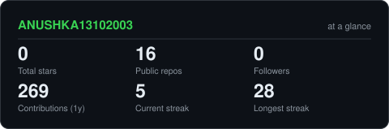
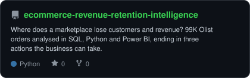
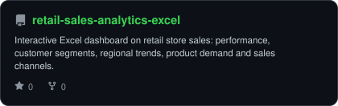
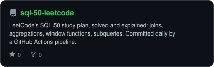

<div align="center">

<!-- PORTRAIT - generated by scripts/dotify.py from a photo. Regenerate with:
       python scripts/dotify.py me.png -o assets/portrait \
         --cols 100 --equalize --detail 0.5 --color --reveal --bg "#0d1117" --pad 4 -->


<br>

<!-- NAME / TAGLINE - animated typing -->
<a href="https://github.com/ANUSHKA13102003">
  
</a>

<br>

<!-- SOCIALS -->
<a href="https://linkedin.com/in/anushka-38b2b227a"></a>
<a href="mailto:itsanushka869@gmail.com"></a>
<a href="https://leetcode.com/u/optimizer86"></a>
<a href="https://www.kaggle.com/anushka1314"></a>


</div>

---

## `~/` whoami

```console
$ cat about.txt
```

Hi, I'm **Anushka**, a final-year B.Tech CSE (Data Science & AI) student at IILM University.
I like the part of analysis where a messy table finally turns into a clear answer someone can act on.

- Currently building **[CommerceLens](https://github.com/ANUSHKA13102003/ecommerce-revenue-retention-intelligence)**: revenue and retention analysis of 99K e-commerce orders
- Working on funnel, cohort and A/B test analysis on real data
- Practising SQL daily through **[SQL 50](https://github.com/ANUSHKA13102003/sql-50-leetcode)**, committed by a GitHub Actions pipeline
- Certifications: Generative AI (Google Cloud), IBM Data Science Foundation, LLMs (Coursera)
- Open to **Data Analyst** and **AI automation** roles and internships

<br>

<div align="center">

## `~/` toolbox


<br>


</div>

---

<div align="center">

## `~/` skill radar

<table>
<tr>
<td width="50%" align="center" valign="middle">

<!-- Self-rated radar - edit assets/skills.json, the workflow redraws it -->
<picture>
  <source media="(prefers-color-scheme: dark)"  srcset="assets/radar-dark.svg">
  <source media="(prefers-color-scheme: light)" srcset="assets/radar-light.svg">
  
</picture>

</td>
<td width="50%" align="center" valign="middle">

<!-- Live radar built from real language byte counts across your repos -->
<picture>
  <source media="(prefers-color-scheme: dark)"  srcset="assets/radar-langs-dark.svg">
  <source media="(prefers-color-scheme: light)" srcset="assets/radar-langs-light.svg">
  
</picture>

</td>
</tr>
</table>

</div>

---

<div align="center">

## `~/` contribution calendar

<!-- 3D isometric calendar, regenerated every 6h by .github/workflows/metrics.yml -->


<br><br>

<!-- Snake eats the contribution graph - .github/workflows/snake.yml -->
<picture>
  <source media="(prefers-color-scheme: dark)"  srcset="https://raw.githubusercontent.com/ANUSHKA13102003/ANUSHKA13102003/output/snake-dark.svg">
  <source media="(prefers-color-scheme: light)" srcset="https://raw.githubusercontent.com/ANUSHKA13102003/ANUSHKA13102003/output/snake.svg">
  
</picture>

</div>

---

<div align="center">

## `~/` the numbers

<!-- Generated by scripts/cards.py into this repo, so it never breaks when a public stats service goes down -->
<picture>
  <source media="(prefers-color-scheme: dark)"  srcset="assets/card-stats-dark.svg">
  <source media="(prefers-color-scheme: light)" srcset="assets/card-stats-light.svg">
  
</picture>

<br>


</div>

---

<div align="center">

## `~/` selected work

<!-- Cards generated by scripts/cards.py from assets/projects.json -->
<a href="https://github.com/ANUSHKA13102003/ecommerce-revenue-retention-intelligence">
  <picture>
    <source media="(prefers-color-scheme: dark)"  srcset="assets/card-ecommerce-revenue-retention-intelligence-dark.svg">
    <source media="(prefers-color-scheme: light)" srcset="assets/card-ecommerce-revenue-retention-intelligence-light.svg">
    
  </picture>
</a>

<table>
<tr>
<td width="50%">
  <a href="https://github.com/ANUSHKA13102003/retail-sales-analytics-excel">
    <picture>
      <source media="(prefers-color-scheme: dark)"  srcset="assets/card-retail-sales-analytics-excel-dark.svg">
      <source media="(prefers-color-scheme: light)" srcset="assets/card-retail-sales-analytics-excel-light.svg">
      
    </picture>
  </a>
</td>
<td width="50%">
  <a href="https://github.com/ANUSHKA13102003/sql-50-leetcode">
    <picture>
      <source media="(prefers-color-scheme: dark)"  srcset="assets/card-sql-50-leetcode-dark.svg">
      <source media="(prefers-color-scheme: light)" srcset="assets/card-sql-50-leetcode-light.svg">
      
    </picture>
  </a>
</td>
</tr>
</table>

</div>

---

<div align="center">

<sub>`SELECT 'thanks for scrolling' AS message;`</sub>

</div>
